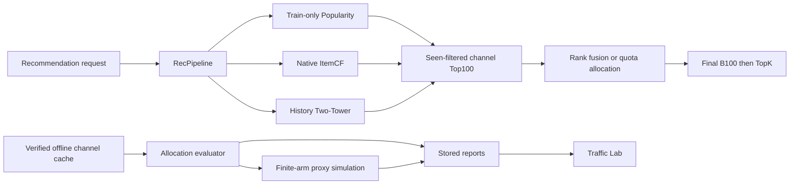
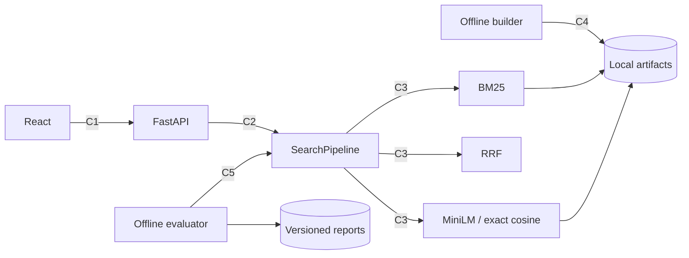

# JoySearch architecture

JoySearch is a modular monolith. The README describes product behaviour; evaluation.md defines the offline protocol. This document describes module boundaries and semantic search.

## Responsibilities

| Module | Owns | Stable boundaries |
|---|---|---|
| data | Schema, catalog IDs, frozen splits and provenance | Input datasets and split membership |
| search | BM25, local MiniLM encoding, RRF, shared features and offline LambdaMART | Recommendation identity or test-based tuning |
| recommendation | Train-only Popularity, sparse ItemCF, history-based Two-Tower and fixed-budget allocation | Search metadata, held-out targets and online business labels |
| traffic | Finite-arm policies and explicit offline proxy simulations | Serving state, observed clicks and causal business estimates |
| evaluation | Fixed-population metrics, paired comparisons and latency | HTTP/UI and model tuning on test judgments |
| api | Request/response contract, readiness and lifecycle | Training and quality formulas |
| frontend | Algorithm selection and observed results | Loading model files or calculating benchmark values |

## Boundaries and failure ownership

| ID | Direction | Contract | Failure and owner |
|---|---|---|---|
| C1 | UI → API | POST /api/v1/search, catalog=wands_search, algorithm=bm25/dense/hybrid/ltr/query_hybrid, top_k=1..100 | API rejects invalid input with 422; unavailable algorithm with 503 |
| C2 | API → SearchPipeline | search(query,k,algorithm) → Candidate[] | Search checks catalog compatibility at load; API reports capability readiness |
| C3 | Pipeline → retrievers/fusion | retrieve(query,k), normalized cosine, rank-only RRF | Domain preserves IDs, stable ties and channel evidence |
| C4 | Offline builder → artifacts | Fixed model revision, ordered catalog, checkpoint and final manifest | Builder rejects changed resume signature; incomplete build stays unavailable |
| C5 | Offline evaluator → pipeline | Same fixed query IDs, catalog and metric formulas for every algorithm | Evaluator rejects mismatched provenance and records every outcome |
| C6 | UI → recommendation API | Anonymous alias, algorithm, seen exclusion and TopK | API validates input; unknown alias explicitly receives cold_user Popularity |
| C7 | RecPipeline → channels/allocation | One Amazon train catalog; Top100 filtered channel lists, quotas and rank evidence | Domain deduplicates, reallocates shortfalls and preserves final B100 |
| C8 | Offline allocation/policy → saved reports → UI | Signed validation selection, frozen held-out cohorts and proxy feedback traces | Offline evaluator owns metrics/simulation; HTTP handlers only read stored results |

Serving uses local artifacts only. Model download is an explicit offline build action. Search requests are read-only; the current app has no account or external write workflow. Response fields remain compatible with P0; debug requests additionally return RRF channel ranks.

Recommendation serving preserves the original baselines. Warm fusion requests use
Popularity, native positive-score ItemCF and ID/history Two-Tower candidates,
exclude seen items and retain a fixed final Top100. Optional quotas are loaded
only when their completed validation artifact matches current model/code/config
signatures. Missing valid history takes the explicit Popularity cold-user path.
The API exposes the chosen route, requested/filled quotas and source ranks; it
does not train or calculate offline metrics.



The traffic module is offline only. UCB receives selected-arm proxy feedback from
the simulator; the serving pipeline does not consume held-out targets or update
an online bandit. See [allocation](allocation.md) for formulas and denominators.



```mermaid
sequenceDiagram
  actor U as User
  participant UI as React
  participant API as FastAPI
  participant P as SearchPipeline
  participant B as BM25
  participant D as Dense
  U->>UI: Select Hybrid and search
  UI->>API: C1 POST /api/v1/search
  API->>API: Validate input and capability
  alt Hybrid available
    API->>P: C2 search(query,k,hybrid)
    P->>B: C3 retrieve(query,100)
    B-->>P: Lexical ranks
    P->>D: C3 retrieve(query,100)
    D-->>P: Semantic ranks
    P->>P: Equal-weight RRF, k=60
    P-->>API: Candidate[] with channel evidence
    API-->>UI: Results, version, latency, trace_id
    UI-->>U: Ranked results and sources
  else Dense artifact unavailable
    API-->>UI: 503 with build instruction
    UI-->>U: Error; BM25 remains selectable
  end
```

UI state: idle → submitting → completed/empty/error. The page retains query input; controls are disabled during submission. Readiness enables only loaded algorithms. Refresh starts a new read-only search session.

Semantic retrieval adds dense.py and fusion.py because encoding/index persistence and rank fusion change independently. Existing SearchPipeline, API schemas, search evaluator and frontend are the direct consumers. Recommendation modules are unchanged. Replacing the embedding model affects the encoder/build configuration and artifacts; changing RRF affects fusion and its configuration, without modifying metric formulas.

LambdaMART adds `features.py` for catalog-only feature extraction and `ranker.py` for offline fitting, persistence and reranking. `scripts/train_ranker.py` invokes domain training with the frozen train/validation query split. The trainer caches real RRF Top100 pools, excludes unjudged rows from supervised fitting and publishes a model manifest after successful fitting. Requests only load the native model and rerank the same Top100 pool, independent of requested output size. Feature order and retrieval signatures are checked when loading. `/readyz` exposes `ltr_ready`; missing LTR artifacts keep the selector unavailable and requests return 503 with the training command.

## Two-Tower recommendation

`two_tower.py` owns history tensor construction, the user/item encoders, native weight loading and full-catalog recommendation. `two_tower_training.py` owns train-only pair construction, negative sampling, optimization and validation checkpoint selection. The CLI invokes training offline; HTTP handlers run inference only.

`RecPipeline` loads optional Two-Tower weights alongside the existing baseline artifacts. Catalog ordering, train-history artifact hash, data split, inference source and weight checksums must agree. A corrupt or incompatible existing model raises an actionable load error. Missing optional weights preserve the baseline algorithms; `/readyz` advertises `recommendation_algorithms` and `two_tower_ready`. Requests for unavailable Two-Tower return 503 with the training command, while unknown algorithms return 422.

The user tower consumes train-history items rather than user IDs. Training removes the target from context; serving uses the same padded-history encoder. Item vectors are computed once at model load, and each request scores one user against the full train catalog. The frontend reads readiness to enable the selector and reads stored metrics for the three-algorithm comparison. No new recommendation metadata or cross-catalog identities are introduced.
