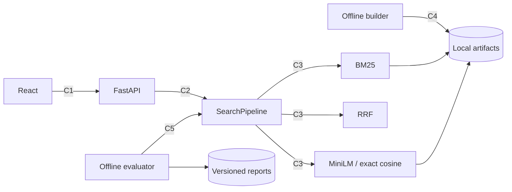

# JoySearch architecture

JoySearch is a modular monolith. The README describes product behaviour; evaluation.md defines the offline protocol. This document describes module boundaries and semantic search.

## Responsibilities

| Module | Owns | Stable boundaries |
|---|---|---|
| data | Schema, catalog IDs, frozen splits and provenance | Input datasets and split membership |
| search | BM25, local MiniLM encoding, exact cosine and RRF | Recommendation identity or training |
| evaluation | Fixed-population metrics, paired comparisons and latency | HTTP/UI and model tuning on test judgments |
| api | Request/response contract, readiness and lifecycle | Training and quality formulas |
| frontend | Algorithm selection and observed results | Loading model files or calculating benchmark values |

## Boundaries and failure ownership

| ID | Direction | Contract | Failure and owner |
|---|---|---|---|
| C1 | UI → API | POST /api/v1/search, catalog=wands_search, algorithm=bm25/dense/hybrid, top_k=1..100 | API rejects invalid input with 422; unavailable algorithm with 503 |
| C2 | API → SearchPipeline | search(query,k,algorithm) → Candidate[] | Search checks catalog compatibility at load; API reports capability readiness |
| C3 | Pipeline → retrievers/fusion | retrieve(query,k), normalized cosine, rank-only RRF | Domain preserves IDs, stable ties and channel evidence |
| C4 | Offline builder → artifacts | Fixed model revision, ordered catalog, checkpoint and final manifest | Builder rejects changed resume signature; incomplete build stays unavailable |
| C5 | Offline evaluator → pipeline | Same fixed query IDs, catalog and metric formulas for every algorithm | Evaluator rejects mismatched provenance and records every outcome |

Serving uses local artifacts only. Model download is an explicit offline build action. Search requests are read-only; the current app has no account or external write workflow. Response fields remain compatible with P0; debug requests additionally return RRF channel ranks.



```mermaid
sequenceDiagram
  actor U as User
  participant UI as React
  participant API as FastAPI
  participant P as SearchPipeline
  participant B as BM25
  participant D as Dense
  U->>UI: Select Hybrid and search
  UI->>API: C1 POST /api/v1/search
  API->>API: Validate input and capability
  alt Hybrid available
    API->>P: C2 search(query,k,hybrid)
    P->>B: C3 retrieve(query,100)
    B-->>P: Lexical ranks
    P->>D: C3 retrieve(query,100)
    D-->>P: Semantic ranks
    P->>P: Equal-weight RRF, k=60
    P-->>API: Candidate[] with channel evidence
    API-->>UI: Results, version, latency, trace_id
    UI-->>U: Ranked results and sources
  else Dense artifact unavailable
    API-->>UI: 503 with build instruction
    UI-->>U: Error; BM25 remains selectable
  end
```

UI state: idle → submitting → completed/empty/error. The page retains query input; controls are disabled during submission. Readiness enables only loaded algorithms. Refresh starts a new read-only search session.

Semantic retrieval adds dense.py and fusion.py because encoding/index persistence and rank fusion change independently. Existing SearchPipeline, API schemas, search evaluator and frontend are the direct consumers. Recommendation modules are unchanged. Replacing the embedding model affects the encoder/build configuration and artifacts; changing RRF affects fusion and its configuration, without modifying metric formulas.

